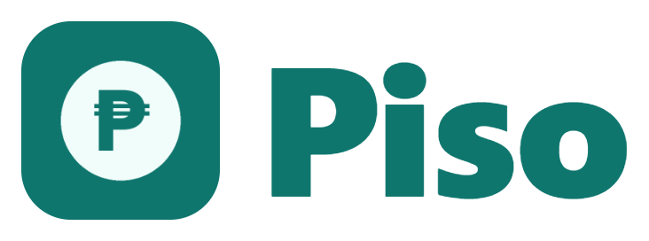
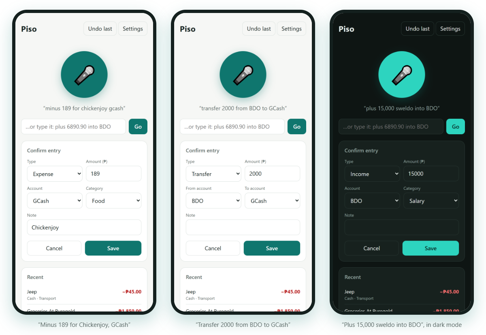

<div align="center">

<h1></h1>

**Say what you spent. It lands in your Google Sheet.**

A voice-first income and expense tracker for your phone. Tap the mic, say *"minus 29 for coffee"* or *"plus 6890.90 into BDO"*, check the card, and the entry is saved to a Google Sheet you own. Free to run: no app store, no subscriptions, no Zapier.


</div>

<p align="center"></p>

```
Phone (installable web app)  →  Google Apps Script  →  Google Sheet
```

## What it does

- **Understands how you actually talk.** Digits or words ("twenty nine", "one fifty", "5 thousand", "1.5k"), English or Taglish ("sweldo 15000 BDO", "minus 60 pamasahe", "gastos 80 kape").
- **Files it for you.** Picks the type, account and category from what you said, using over 600 words for Philippine restaurants, stores, bills, foods and everyday things.
- **Checks before saving.** Every entry shows a confirm card you can fix with one tap. Fix a category once and Piso remembers it for next time.
- **Handles transfers.** "Transfer 2000 from BDO to GCash", "cash in 500 to GCash" or "withdraw 1000 from BDO" moves money between accounts without counting it as income or spending.
- **Forgives mishearings.** Chrome can return several guesses; Piso keeps the one that makes sense. "Maia", "G-Cash" and "B.D.O." still find the right account.
- **Works offline.** No signal? Entries wait on your phone and are sent when you're back online, never twice.
- **Undoes exactly one thing.** **Undo last** removes the newest entry, both halves of a transfer included.
- **Keeps your data yours.** Entries go straight to your own Google Sheet, behind a secret token only your phone knows.

## Set up

About 20 minutes, once.

### 1. The sheet and its backend

1. Create a Google Sheet (for example, named **Piso**).
2. In the sheet, **Extensions → Apps Script**. Replace the code with [`backend/Code.gs`](backend/Code.gs). In **Project Settings**, tick *Show "appsscript.json" manifest file* and replace that file with [`backend/appsscript.json`](backend/appsscript.json).
3. Pick **`setupSheets`** in the function list and click **Run**. Approve the permissions. Google warns that it hasn't verified the app: choose **Advanced → Go to … (unsafe)**, since it is your own script. This creates the *Transactions*, *Accounts* and *Summary* tabs.
4. Open **Execution log** and copy the line **`Your Piso token: …`**. It is stored in **Project Settings → Script Properties**, never in the code.
5. **Deploy → New deployment → Web app**, execute as **Me**, access **Anyone**. Copy the **Web app URL**. Opening it should say *Piso is alive*.

<details>
<summary>Prefer the command line? Use clasp</summary>

```
npm install -g @google/clasp
clasp login
clasp create-script --title "Piso backend" --parentId <your sheet id> --rootDir backend
clasp push
clasp create-deployment --description "Piso v1"
```

Then run `setupSheets` once in the editor (step 3 above), because Google only lets the owner grant permissions. This repo's `.clasp.json` points at the author's script; `clasp create-script` replaces it with yours.
</details>

### 2. Host the app

Fork or push this repo to GitHub, then **Settings → Pages → Source: GitHub Actions**. Every push to `main` runs the tests and publishes the [`app/`](app/) folder at `https://<you>.github.io/piso/`.

The token is **not** in any file. You type it into the app on your phone, so a public repo is fine.

### 3. Install it on your phone

1. Open your Pages address in **Chrome** on Android.
2. In **Settings**, paste the Web app URL and the token, list your accounts, and tap **Save settings**.
3. Chrome menu **⋮ → Add to Home screen** (or **Install app**).
4. Tap the mic and allow microphone access.

## Use

Tap the mic and speak, or type into the box. Check the card, then **Save**.

| You say | Piso saves |
| --- | --- |
| "Minus 29 for coffee" | Expense ₱29 · Cash · Food · *Coffee* |
| "Plus 6890.90 into BDO" | Income ₱6,890.90 · BDO |
| "Spent 150 on lunch using GCash" | Expense ₱150 · GCash · Food · *Lunch* |
| "Minus one fifty for jeep" | Expense ₱150 · Cash · Transport |
| "Sweldo 15000 BDO" | Income ₱15,000 · BDO · Salary |
| "Minus 1,850 for groceries at Puregold" | Expense ₱1,850 · Cash · Groceries |
| "Minus 2,300 for Cepalco" | Expense ₱2,300 · Cash · Load/Bills |
| "Transfer 2000 from BDO to GCash" | Transfer ₱2,000 · BDO → GCash |
| "Withdraw 1000 from BDO" | Transfer ₱1,000 · BDO → Cash |
| "Plus 12,000 into BPI opening balance" | Income ₱12,000 · BPI · Opening Balance |

If you don't name an account, the **default account** from Settings is used.

### Accounts

- **Add one** in the app's **Settings → Accounts** (comma separated). The sheet's *Accounts* tab picks up every account you use by itself.
- **Start it at its real balance** by saying "plus 12,000 into BPI opening balance". Opening balances count toward the account's balance but not toward the month's income.
- **Nicknames:** if you call an account something Piso doesn't know, add it under **Settings → Nicknames**, like `bpi family=BPI, ewallet=GCash`. Common banks and e-wallets (BPI, Metrobank, UnionBank, Landbank, GoTyme, SeaBank, ShopeePay, Coins.ph and more) are already understood once they are in your list.

### The sheet

- **Transactions** has one row per entry (two for a transfer), with what you said in *Raw text*.
- **Accounts** lists the income, spending and balance of each account, plus the total.
- **Summary** shows this month's spending by category, and the month's income and expense totals. Transfers and opening balances are left out.

### Undo and offline

- **Undo last** asks first, then removes the newest entry in *Recent*.
- With no signal, the entry is marked *queued* and sent when you're back online. Each entry has an ID, so a retry is never saved twice.

## Teach it your words

Piso learns two ways.

1. **By itself.** When you change the category on the confirm card, the note is remembered on your phone ("ulam" → Food) and wins over the built-in words next time.
2. **In [`app/vocabulary.js`](app/vocabulary.js).** All the words live there: account aliases, categories and their keywords, and the words that mean *plus*, *minus* or *transfer*. Add your favourite carinderia or sari-sari store, run `npm test`, and push. Longer phrases win, so "grab food" (Food) beats "grab" (Transport).

To see where Piso still gets you wrong, download the *Transactions* tab as CSV (**File → Download → CSV**) and run:

```
npm run audit -- "Piso - Transactions.csv"
```

It re-reads everything you've said and lists each entry you had to correct. Each one is a good new test case.

## Good to know

- Anyone with your Web app URL **and** token can add rows to your sheet. Keep both private. To change the token, edit `TOKEN` in **Script Properties** and update it on your phone.
- Voice uses Chrome's speech recognition, which needs internet and sometimes mishears. That's what the confirm card is for. The typed box and your keyboard's mic work as fallbacks.
- Speech language can be English (Philippines), Filipino or English (US), in **Settings**.
- After an update, close and reopen the app once while online to get the new version.

## Project layout

Plain JavaScript, no dependencies and no build step.

| Path | What it is |
| --- | --- |
| `app/index.html` | The app: mic, confirm card, recent list, settings, offline queue |
| `app/parser.js` | Turns what you said into an entry: numbers, type, account, category, note |
| `app/vocabulary.js` | The words Piso listens for. Edit this one to teach it yours |
| `app/sw.js`, `app/manifest.json` | Offline cache and install details |
| `backend/Code.gs` | The Apps Script web app: saves, undoes, skips duplicates, builds the tabs |
| `tests/` | Parser cases, and the backend run against a fake in-memory sheet |
| `scripts/` | Live backend check, the CSV audit, and the screenshot generator |
| `.github/workflows/ci.yml` | Runs the tests, then publishes `app/` to GitHub Pages |

## Tests

Needs [Node.js](https://nodejs.org) 20 or newer. Nothing to install.

```
npm test                 # parser cases + backend against a fake sheet
npm run smoke            # live check of your deployed backend (adds a ₱1 entry, then removes it)
npm run screenshots      # regenerates the pictures in docs/ (needs Chrome)
```

`npm run smoke` reads the URL and token from `PISO_URL` and `PISO_TOKEN`, so they never end up in the repo. GitHub runs `npm test` on every push.

### Updating the backend

```
clasp push
clasp update-deployment <deployment id> --description "what changed"
```

Updating the existing deployment keeps the Web app URL the same, so the phone needs no changes.

## License

Copyright © 2026 [ChimCatz](https://github.com/ChimCatz). Released under the [MIT License](LICENSE).

---

<p align="center">
  Built by <a href="https://github.com/ChimCatz">ChimCatz</a> ·
  part of the <a href="https://github.com/ChimCatz/cz-portfolio-site">project portfolio</a>
</p>
